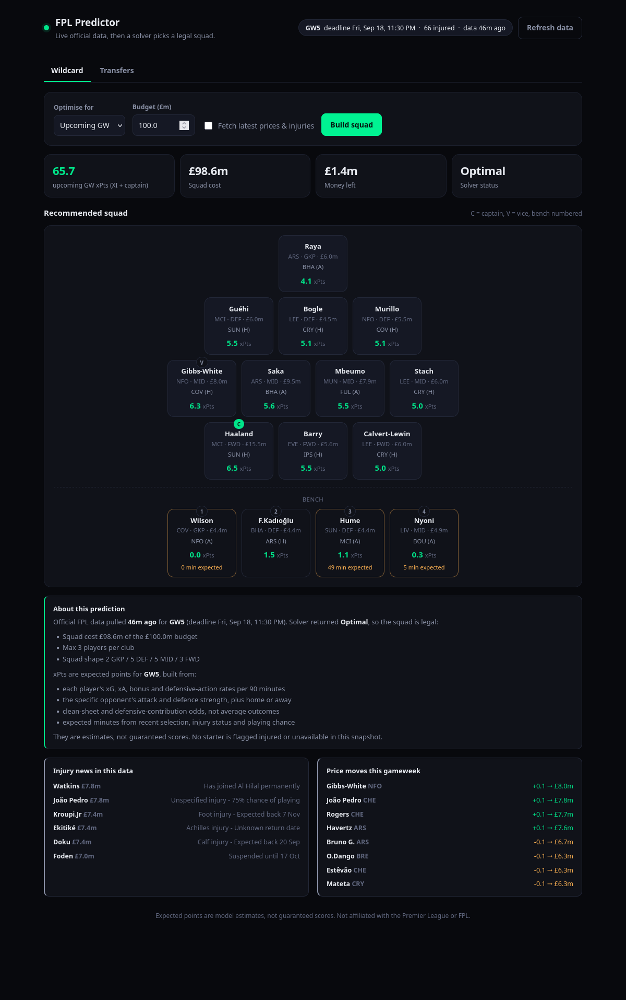

# FPL Predictor

Build a legal Fantasy Premier League **wildcard** squad, or the best **transfers** from your current 15.

It pulls live prices, injuries, and fixtures from the official FPL API, projects each player against **the specific opponent they face**, then a solver picks the team. It will not break budget, club, or position rules.

Python 3.12+ required.



## Try it

```bash
git clone https://github.com/g-schatten/FPL-Predictor.git
cd FPL-Predictor
python3 -m venv .venv
source .venv/bin/activate   # Windows: .venv\Scripts\activate
pip install -e .
fpl serve
```

`fpl serve` opens a local dark UI on <http://localhost:8000> with two tabs: **Wildcard** and **Transfers**. Nothing leaves your machine except read-only calls to the official FPL API, and no login is needed.

Prefer the terminal? Every feature is also a command:

```bash
fpl wildcard
```

That refresh + solve is the whole demo: a 15-man squad for the upcoming gameweek on a £100.0m budget. After the table it prints when the FPL data was pulled and that the squad is a legal solver output, not a guaranteed score.

By default both modes optimise for the **upcoming gameweek**. Useful flags:

```bash
fpl wildcard --horizon 3 --budget 100.0   # plan across the next 3 GWs instead
fpl wildcard --no-refresh                 # reuse the last download
fpl status                                # current deadline, injuries, price moves
```

## How the projection works

Expected points are built per player-fixture, not from last week's score:

- **Player rates**: xG, xA, bonus, defensive actions, saves and cards per 90, shrunk toward
  the position median so a one-game hot streak doesn't become a season-long rate.
- **Opponent**: team attack and defence strength from results and xG, so a striker facing the
  worst defence at home projects higher than the same striker away at the best one.
- **Probabilities, not averages**: clean sheets and the defensive-contribution bonus come from
  Poisson tails, and the goals-conceded penalty from `E[floor(conceded/2)]`.
- **Minutes**: P(appear) and P(60+) from recent selection, times injury status and playing chance.

Measured against the 2025-26 season, walk-forward, it beats the form-based heuristic it
replaced on every ranking metric, and the squads it picks scored ~8 more points per gameweek:

| method | NDCG@20 | top-20 capture | solved XI+captain, actual pts/GW |
|---|---|---|---|
| this engine | **0.388** | **0.402** | **58.6** |
| form × fixture difficulty | 0.330 | 0.345 | 50.2 |
| last-4-GW points per 90 | 0.310 | 0.330 | 48.8 |
| price | 0.289 | 0.299 | 36.2 |

Reproduce it yourself, including the probability calibration checks:

```bash
fpl backtest --season 2025-26
```

Full method, parameter sweeps, and caveats: [docs/EVAL.md](docs/EVAL.md).

## Transfers for your team

FPL manager id is in the URL on your Points page, e.g. `.../entry/1234567/`.

```bash
fpl refresh
fpl squad import-entry 1234567 --bank 0.5 --ft 1
fpl transfers --max-hits 1
```

`--bank` is money in the bank in £m. `--ft` is free transfers. FPL does not publish those, so you type them.

Or save the 15 yourself:

```bash
fpl squad save --ids 1,2,3,4,5,6,7,8,9,10,11,12,13,14,15 --bank 0.5 --ft 1
fpl transfers
```

## Commands

| Command | What it does |
|---|---|
| `fpl serve` | Local dark web UI for both modes (`--port`, `--no-open`) |
| `fpl backtest` | Walk-forward test of the projection engine vs baselines |
| `fpl wildcard` | Best legal 15 from scratch |
| `fpl transfers` | Best legal moves from a saved squad |
| `fpl refresh` | Download latest prices, injuries, fixtures |
| `fpl status` | Show the stored snapshot |
| `fpl squad show` | Print your saved 15 |
| `fpl train` | Optional historical model (live data still wins until this beats a form baseline) |

`fpl refresh --full` also downloads per-player histories. Slower; slightly better minutes.

## Honest limits

- “Best” means best under this model’s expected points, not a guaranteed rank finish.
- Backtest gains come from one season under the current ruleset, and every method there could
  rebuild its squad weekly with no transfer cost. Treat the gap between methods as the signal,
  not the absolute points.
- No Club Elo, head-to-head history, or European rotation risk yet. Set-piece and penalty
  duties are not used because they can't be validated against the historical archive.
- Injured / 0% availability players are not bought into new squads.
- The UI is a local server for you only; it is not a hosted site and never asks for FPL credentials.

Not affiliated with the Premier League or FPL.
